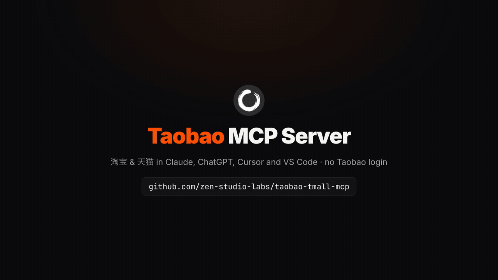
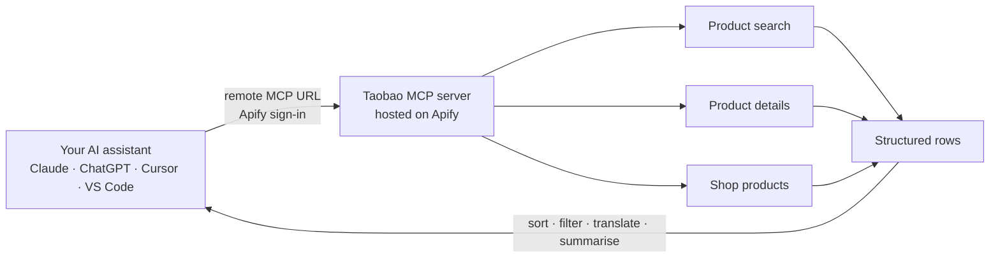

<div align="center">


# Taobao (淘宝) & Tmall (天猫) MCP Server

**Taobao (淘宝) and Tmall (天猫) product data inside Claude, ChatGPT, Cursor and your own code: search products, compare prices and sales, read SKU variants and buyer reviews, list a shop's products. Hosted and read-only. No Taobao login, no cookies, nothing to install.**

**English** · [简体中文](README.zh-CN.md)

[](https://apify.com/zen-studio/taobao-detail-scraper)
[](https://github.com/zen-studio-labs/taobao-tmall-mcp/actions/workflows/validate.yml)
[](LICENSE)



<sub>Built from a real search run on 2 November 2026.</sub>

[](https://cursor.com/en/install-mcp?name=taobao&config=eyJ1cmwiOiJodHRwczovL21jcC5hcGlmeS5jb20vP3Rvb2xzPWZldGNoLWFjdG9yLWRldGFpbHMsZ2V0LWFjdG9yLXJ1bixnZXQtZGF0YXNldC1pdGVtcyx6ZW4tc3R1ZGlvL3Rhb2Jhby1zZWFyY2gtc2NyYXBlcix6ZW4tc3R1ZGlvL3Rhb2Jhby1kZXRhaWwtc2NyYXBlcix6ZW4tc3R1ZGlvL3Rhb2Jhby1zZWxsZXItcHJvZHVjdHMtc2NyYXBlciJ9)
[](https://vscode.dev/redirect/mcp/install?name=taobao&config=%7B%22type%22%3A%22http%22%2C%22url%22%3A%22https%3A%2F%2Fmcp.apify.com%2F%3Ftools%3Dfetch-actor-details%2Cget-actor-run%2Cget-dataset-items%2Czen-studio%2Ftaobao-search-scraper%2Czen-studio%2Ftaobao-detail-scraper%2Czen-studio%2Ftaobao-seller-products-scraper%22%7D)
[](#client-setup)

[Quick start](#quick-start) · [Agent setup](#set-up-with-your-ai-agent) · [Tools](#tools) · [Prompts](#example-prompts) · [Client setup](#client-setup) · [API](#use-it-as-a-taobao-api) · [Pricing](#pricing) · [FAQ](#faq)

</div>

Taobao MCP is a hosted Taobao MCP server that connects your AI assistant to Taobao (淘宝) and Tmall (天猫), Alibaba's two consumer marketplaces in China. Ask in English or Chinese: your assistant searches products by keyword with price range, sales sorting and a Tmall-only filter, reads a product's full listing with its SKU variants, prices, stock levels, attributes and images, adds buyer reviews when you want them, and lists everything a shop sells. Results come back as structured rows it can sort, filter, translate and summarise, for price research, product sourcing, cross-border buying and brand monitoring. Developers can call the same tools as a Taobao API.

## Why Taobao MCP

- **No Taobao account, no keys.** No QR-code login, no cookies, no Taobao Union (淘宝联盟) PID or open-platform app key. Your own Taobao account is never used, so it is never at risk.
- **Nothing to install.** Add one URL and sign in with Apify. Works in claude.ai and ChatGPT too, not only in desktop apps.
- **Taobao and Tmall in one server.** Product search, full product details with optional buyer reviews, and shop product lists, for Taobao shops and Tmall flagship stores alike.
- **Rich, structured data.** Prices and discounted prices in yuan, sales, SKU variants with their own price and stock, attributes, brand, category, images and video, shop names, positive-rating rates and shop scores, ship-from city, and buyer reviews with photos and seller replies.
- **Maintained for you.** Used by more than 10,000 people on the Apify Store. When Taobao changes, the tools are updated; your setup stays the same.
- **Made for assistants.** A bundled skill teaches your assistant the inputs that work and how to chain the tools, and long requests keep running while it checks back.
- **Pay per result.** Plus a small start fee per run, billed to your own Apify account. No subscription; try it on Apify's free plan.

| | Taobao MCP | Typical self-hosted Taobao tools |
|---|---|---|
| Taobao account, QR login or cookies | Not needed | Usually required, and logins expire |
| Taobao Union PID or open-platform keys | Not needed | Required by affiliate-link and merchant tools |
| Your own Taobao account | Never used | Sends every request, so the account carries the risk |
| Setup | One URL and an Apify sign-in | Python or Node, a local Chrome with a logged-in session, or Docker |
| Web assistants (claude.ai, ChatGPT) | Supported | Usually desktop clients only |
| When Taobao changes | Updated for you | Wait for a fix, or fix it yourself |
| SKUs, buyer reviews, shop product lists | All included | Varies; affiliate tools return links and commissions |
| Cost | Pay per result | Free software, your own machine and time |

## How it works



Each tool call starts a run on your Apify account. Your assistant waits for it, reads the rows, and answers in plain language. Chain the tools for deeper answers: search a keyword, open the top products for their SKU variants and reviews, then list what else their shops sell.

## Quick start

1. **Create a free [Apify account](https://console.apify.com/sign-up)** if you do not have one.
2. **Add the server to your assistant.** Click a button above, or follow the steps for your client below.
3. **Sign in with Apify when your assistant asks**, then ask a question such as *"Find the best-selling mechanical keyboards (机械键盘) on Taobao and compare shop, price, sales and shop rating."*

**About the Apify sign-in page.** Apify notes that your assistant "was registered dynamically and wasn't verified by Apify" and asks for full API access. Every assistant that signs in this way sees that notice; it lets your assistant start runs on your account. You can remove the access at any time on your [Apify Console integrations page](https://console.apify.com/settings/integrations).

Server URL, for any client that accepts a remote MCP server:

```text
https://mcp.apify.com/?tools=fetch-actor-details,get-actor-run,get-dataset-items,zen-studio/taobao-search-scraper,zen-studio/taobao-detail-scraper,zen-studio/taobao-seller-products-scraper
```

## Set up with your AI agent

Paste this repository's URL into Claude Code, Codex, Cursor or another agent and ask it to set up Taobao MCP. The steps below are written so your agent can follow them.

**For AI agents installing this server:**

1. This is a hosted remote MCP server (streamable HTTP). There is nothing to download or build. It needs a free Apify account and an Apify sign-in (OAuth) in the user's browser; do not ask for an API token unless the sign-in fails.
2. Server name `taobao`, server URL:
   ```text
   https://mcp.apify.com/?tools=fetch-actor-details,get-actor-run,get-dataset-items,zen-studio/taobao-search-scraper,zen-studio/taobao-detail-scraper,zen-studio/taobao-seller-products-scraper
   ```
3. Add it with the client's own command:
   - Claude Code: `claude plugin marketplace add zen-studio-labs/taobao-tmall-mcp`, then `claude plugin install taobao@taobao-tmall-mcp` (adds the server and the Taobao skill).
   - Codex: `codex mcp add taobao --url "<server URL>"`, then `codex mcp login taobao`.
   - VS Code: `code --add-mcp '{"name":"taobao","type":"http","url":"<server URL>"}'`.
   - Cursor and other clients: add `{"mcpServers": {"taobao": {"url": "<server URL>"}}}` to the client's MCP config file (Cursor: `~/.cursor/mcp.json`).
4. Ask the user to complete the sign-in. In Claude Code they run `/mcp`, select taobao and choose **Authenticate**; other clients open the Apify sign-in page themselves. A client restart may be needed before the tools appear.
5. Check it works without starting a paid run: call `fetch-actor-details` for `zen-studio/taobao-detail-scraper` and confirm it returns the input reference. Do not run test requests: on Apify's free plan every run counts against a small allowance (5 search runs and 10 details runs in total), so keep runs for the user's real requests.
6. Before real requests, read the [Taobao skill](skills/taobao/SKILL.md): it explains how long runs work, how the tools chain together and which inputs return good results.

## Tools

| Tool | What you get | Store page |
|---|---|---|
| Product search | Taobao and Tmall products for a keyword with title, price and discounted price, sales band (such as `1万+`), shop name, positive-rating rate, the three shop scores and ship-from city. Sort by relevance, sales or highest price; filter by price range or Tmall only. Optional full details for each product and buyer reviews. Up to 1,000 products per keyword. | [taobao-search-scraper](https://apify.com/zen-studio/taobao-search-scraper) |
| Product details | The full listing from a product link, share link (`e.tb.cn`), affiliate link or item ID: SKU variants with their own price and stock, attributes, brand, category, images, description images, video, shop, ship-from location and sales. Optional buyer reviews with photos, seller replies and follow-up reviews. Up to 1,000 products per run. | [taobao-detail-scraper](https://apify.com/zen-studio/taobao-detail-scraper) |
| Shop products | Everything a shop sells, from any product link from the shop (recommended), a Taobao shop link, a seller handle such as `inman`, or a seller ID with its shop ID: title, price and discounted price, 30-day sales and orders where Taobao shows them, comment count, free shipping, category and shop scores. Sort by recommended, best selling, newest, lowest or highest price. Up to 5,000 products per shop. | [taobao-seller-products-scraper](https://apify.com/zen-studio/taobao-seller-products-scraper) |

All tools are read-only. They never log in, add to cart, buy, message sellers or leave reviews.

<details>
<summary><b>Key fields per tool</b></summary>

| Tool | Key fields |
|---|---|
| Product search | `itemId`, `url`, `title`, `price`, `discountedPriceFromSearch`, `salesSignal` (sales band), `shop.shopNameFromSearch`, `shop.shopIdFromSearch`, `sellerGoodrat` (positive rate, %), `miaoshuDsr`, `fuwuDsr`, `fahuoDsr` (description, service and shipping scores out of 5), `sellerLoc`, `searchRank`; with `enrichWithDetails`, also the Product details fields such as `isTmall`, `sales`, `skus` and `attributes`; with `fetchReviews`, `reviews[]` |
| Product details | `itemId`, `url`, `isTmall`, `title`, `price`, `originalPrice`, `sales`, `totalSold`, `stock`, `skuCount`, `skus[]` (price and stock per variant), `attributes`, `brandName`, `categoryCrumbs`, `mainPictureUrl`, `pictures`, `descriptionImages`, `video`, `shop.shopName`, `shop.shopUrl`, `shop.sellerId`, `location`, `detailLevel`; with `fetchReviews`, `reviews[]` with `content`, `date`, `photos`, `reply`, `appendList`, `useful` |
| Shop products | `shopName`, `shopUrl`, `sellerId`, `shopId`, `itemId`, `url`, `title`, `price`, `discountPrice`, `soldCount30Day`, `orderCount30Day`, `commentCount`, `freeShipping`, `shop.descriptionMatchScore`, `shop.serviceScore`, `shop.deliveryScore`, `catalog.rank`, `catalog.totalCount` |

Each Store page lists every field.

</details>

## Example prompts

**Price research and comparison**
- *Compare 机械键盘 prices on Taobao: the 20 best sellers between ¥200 and ¥600, with shop, discounted price, sales and shop rating.*
- *Is this keyboard cheaper in another shop? Search the model name and list the five lowest prices with their shops: https://item.taobao.com/item.htm?id=844075013790*

**Product sourcing and cross-border buying**
- *Get every colour and size of this product with its own price and stock, and translate the options into English: https://item.taobao.com/item.htm?id=844075013790*
- *Find Tmall-only listings for 筋膜枪 under ¥300 and rank them by sales.*

**Brand and shop monitoring**
- *List the best-selling products of the shop behind this listing and show price, discounted price and 30-day sales: https://item.taobao.com/item.htm?id=844075013790*
- *Which shops sell Lego on Taobao, and which of them are Tmall flagship stores?*

**Buyer reviews**
- *Read 50 buyer reviews of this product and group the complaints by topic: https://item.taobao.com/item.htm?id=844075013790*
- *Do reviewers of the top three 空气炸锅 mention noise or smell? Quote the reviews that do.*

**In Chinese**
- *搜索淘宝上销量最高的机械键盘，对比店铺、价格、销量和店铺评分。*
- *查一下这家天猫旗舰店卖得最好的20个商品，列出价格和月销量。*

Tip: for Chinese products, search in Chinese (`机械键盘`, `连衣裙`, `空气炸锅`); that is how sellers title their listings. Brand and model names such as `Lego` or `G87` work as they are.

## Client setup

<details open>
<summary><b>Claude (claude.ai and Claude Desktop)</b></summary>

1. Open **Settings** > **Connectors** and select **Add custom connector**.
2. Name it `Taobao` and paste the server URL above.
3. Select **Connect** and sign in with Apify.
4. In a chat, enable the Taobao connector from the tools menu.

The connector syncs between claude.ai and Claude Desktop. Custom connector availability depends on your Claude plan. For better results, also add the [Taobao skill](skills/taobao/SKILL.md): download [taobao-skill.zip](https://github.com/zen-studio-labs/taobao-tmall-mcp/releases/latest/download/taobao-skill.zip) and upload it under **Skills** in Claude's settings.

</details>

<details>
<summary><b>Claude Code</b></summary>

Plugin (server plus the Taobao skill, recommended):

```text
/plugin marketplace add zen-studio-labs/taobao-tmall-mcp
/plugin install taobao@taobao-tmall-mcp
```

Server only:

```bash
claude mcp add --transport http taobao "https://mcp.apify.com/?tools=fetch-actor-details,get-actor-run,get-dataset-items,zen-studio/taobao-search-scraper,zen-studio/taobao-detail-scraper,zen-studio/taobao-seller-products-scraper"
```

Then sign in: run `/mcp`, select the taobao server and choose **Authenticate**. Until you do, `/mcp` lists the server as not authenticated and may say its tools could not be fetched; both clear once you sign in.

</details>

<details>
<summary><b>Cursor</b></summary>

Click **Install in Cursor** above, or add [`examples/cursor-mcp.json`](examples/cursor-mcp.json) to `~/.cursor/mcp.json` (all projects) or `.cursor/mcp.json` (one project). Cursor asks you to sign in with Apify on first use.

</details>

<details>
<summary><b>VS Code and GitHub Copilot</b></summary>

Click **Install in VS Code** above ([VS Code Insiders](https://insiders.vscode.dev/redirect/mcp/install?name=taobao&config=%7B%22type%22%3A%22http%22%2C%22url%22%3A%22https%3A%2F%2Fmcp.apify.com%2F%3Ftools%3Dfetch-actor-details%2Cget-actor-run%2Cget-dataset-items%2Czen-studio%2Ftaobao-search-scraper%2Czen-studio%2Ftaobao-detail-scraper%2Czen-studio%2Ftaobao-seller-products-scraper%22%7D&quality=insiders)), or add [`examples/vscode-mcp.json`](examples/vscode-mcp.json) to `.vscode/mcp.json`. Start the server from the MCP view and sign in with Apify when prompted. Use the tools in Copilot Chat agent mode.

</details>

<details>
<summary><b>ChatGPT</b></summary>

1. Open [ChatGPT Plugins](https://chatgpt.com/plugins), select **+**, then **Add custom MCP server**.
2. Name it `Taobao`, paste the server URL above, and choose **OAuth** authentication.
3. Confirm, create the plugin, and sign in with Apify.
4. In a new chat, type `@` and select **Taobao**.

Business, Enterprise and Edu workspaces may need an admin to enable custom servers. See OpenAI's [custom MCP server guide](https://help.openai.com/en/articles/12584461-connecting-custom-mcp-servers-in-chatgpt).

</details>

<details>
<summary><b>Codex</b></summary>

```bash
codex mcp add taobao --url "https://mcp.apify.com/?tools=fetch-actor-details,get-actor-run,get-dataset-items,zen-studio/taobao-search-scraper,zen-studio/taobao-detail-scraper,zen-studio/taobao-seller-products-scraper"
codex mcp login taobao
```

Or copy [`examples/codex-config.toml`](examples/codex-config.toml) into `~/.codex/config.toml`.

</details>

<details>
<summary><b>Other clients, or a token instead of sign-in</b></summary>

Most clients that support remote MCP servers accept:

```json
{
  "mcpServers": {
    "taobao": {
      "url": "https://mcp.apify.com/?tools=fetch-actor-details,get-actor-run,get-dataset-items,zen-studio/taobao-search-scraper,zen-studio/taobao-detail-scraper,zen-studio/taobao-seller-products-scraper"
    }
  }
}
```

If your client cannot complete the Apify sign-in, send your Apify token as a header instead, see [`examples/bearer-token-mcp.json`](examples/bearer-token-mcp.json). Copy the token from your [Apify Console integrations page](https://console.apify.com/settings/integrations) and keep it out of shared files. Clients that only run local servers can bridge with `mcp-remote`, see [`examples/claude-desktop-config.json`](examples/claude-desktop-config.json).

</details>

## Use it as a Taobao API

Each tool is also an [Apify Actor](https://apify.com/zen-studio) with a REST API, so you can call it from your own code, a pipeline or an automation, without an assistant. Copy your API token from the [Apify Console integrations page](https://console.apify.com/settings/integrations). The input fields are the same ones the assistant uses; each Store page has an **API** tab with ready-made code and the full input reference.

<details open>
<summary><b>Python</b></summary>

```bash
pip install apify-client
```

```python
import os
from apify_client import ApifyClient

client = ApifyClient(os.environ["APIFY_TOKEN"])
run = client.actor("zen-studio/taobao-search-scraper").call(
    run_input={"keyword": "机械键盘", "maxItems": 20, "sort": "sales", "enrichWithDetails": False}
)
for item in client.dataset(run["defaultDatasetId"]).iterate_items():
    if item.get("error") or "price" not in item:
        print("notice:", item.get("message") or item.get("error"))  # not a product row
        continue
    print(item["price"], item.get("salesSignal"), item["title"], item["url"])
```

</details>

<details>
<summary><b>JavaScript and TypeScript</b></summary>

```bash
npm install apify-client
```

```js
import { ApifyClient } from 'apify-client';

const client = new ApifyClient({ token: process.env.APIFY_TOKEN });
const run = await client.actor('zen-studio/taobao-detail-scraper').call({
    items: ['https://item.taobao.com/item.htm?id=844075013790'],
    fetchReviews: true,
    maxReviewsPerItem: 20,
});
const { items } = await client.dataset(run.defaultDatasetId).listItems();
console.log(items);
```

</details>

<details>
<summary><b>HTTP</b></summary>

Start a run and get its results in one request:

```bash
curl -X POST "https://api.apify.com/v2/acts/zen-studio~taobao-search-scraper/run-sync-get-dataset-items" \
  -H "Authorization: Bearer $APIFY_TOKEN" \
  -H "Content-Type: application/json" \
  -d '{"keyword": "机械键盘", "maxItems": 20, "sort": "sales"}'
```

This waits up to 300 seconds. For bigger runs, start the run asynchronously and read its dataset when it finishes, see the [Apify API reference](https://docs.apify.com/api/v2/act-run-sync-get-dataset-items-post).

</details>

<details>
<summary><b>n8n, Make and Zapier</b></summary>

Use Apify's official integration for [n8n](https://docs.apify.com/platform/integrations/n8n), [Make](https://docs.apify.com/platform/integrations/make) or [Zapier](https://docs.apify.com/platform/integrations/zapier), choose the Actor (for example `zen-studio/taobao-search-scraper`) and pass the same JSON input.

</details>

Other tools: replace the Actor ID with `zen-studio/taobao-detail-scraper` or `zen-studio/taobao-seller-products-scraper`.

## Use cases

- **Price research.** Current prices, discounted prices and sales for a product type, a brand or a model, across shops.
- **Product sourcing.** Find what sells, then read the SKU variants, options and stock levels before you order or list it.
- **Cross-border buying and shopping agents (代购).** Turn a customer's Taobao or Tmall link into a translated listing with its variants and prices.
- **Brand monitoring.** Which shops sell your brand, at what price, and which are Tmall flagship or authorised stores.
- **Shop and competitor tracking.** A shop's full product list with prices and 30-day sales, sorted the way you need.
- **Review analysis.** Buyer reviews with photos and seller replies, ready for sentiment and complaint analysis.

## Example output

One search row from the run on 2 November 2026, abridged. Your assistant reads rows like this and answers in plain language.

```json
{
  "itemId": "844075013790",
  "url": "https://item.taobao.com/item.htm?id=844075013790",
  "title": "迈从Ace 68V2 磁轴机械键盘60Pro游戏电竞台式电脑客制化打瓦桌搭",
  "priceCurrency": "CNY",
  "price": "499.00",
  "discountedPriceFromSearch": "279.35",
  "salesSignal": "1万+",
  "shop": {
    "shopIdFromSearch": "521309573",
    "shopNameFromSearch": "迈从官方旗舰店"
  },
  "sellerGoodrat": 100,
  "miaoshuDsr": 4.87,
  "fuwuDsr": 4.88,
  "fahuoDsr": 4.88,
  "searchKeyword": "机械键盘",
  "searchSort": "sales",
  "searchRank": 1
}
```

## How long requests work

Each tool call returns within about 45 seconds. Bigger requests keep running on Apify after that, and your assistant checks back until the results are ready, then reads them in pages. You may see a few "still running" updates; that is expected. The [Taobao skill](skills/taobao/SKILL.md) teaches assistants this flow, along with input recipes for each tool. Claude Code gets it with the plugin.

## Pricing

Pay per result plus a small start fee per run, billed to your Apify account. There is no subscription to this repository. Current prices, including volume discounts, are on each tool's pricing page:

- [Product search](https://apify.com/zen-studio/taobao-search-scraper/pricing)
- [Product details](https://apify.com/zen-studio/taobao-detail-scraper/pricing)
- [Shop products](https://apify.com/zen-studio/taobao-seller-products-scraper/pricing)

Your assistant controls cost through result caps such as `maxItems`, `maxItemsPerSeller` and `maxReviewsPerItem`. Ask for a small number first, then scale up. In Product search, full product details are on by default and billed per product, and buyer reviews are billed per review in both search and details; turn them off when you only need prices and sales.

**Free Apify plan:** a few previews per tool with small caps. Product search: 5 runs in total, one page of 10 products per run, with full details for the first product only. Product details: 10 runs, one product per run. Shop products: 10 runs, up to 20 products per run. Buyer reviews need a paid plan. The free preview can be temporarily unavailable; try again later, or use any paid Apify plan. Any paid Apify plan removes these caps.

## Limitations

- **Prices are indicative, in yuan (CNY).** In Product details, `price` is the current selling price with active promotions and `originalPrice` the pre-discount price when there is one. In Product search, `price` is the search-result price when details are off; with details on (the default) it is replaced by the Product details price, and `priceFromSearch` keeps the search-result price. `discountedPriceFromSearch` is the discounted price shown in search. These can differ for the same product, so say which one you quote. `couponPrice` (券后价) is often empty, so the price at checkout can be lower; `priceVerified: true` marks a confirmed `price`. Re-check a price before you buy against it.
- **SKU lists can be incomplete.** On some listings Product details returns fewer variants than the product page shows. Compare with the page when you need every option.
- **Search shows sales as bands.** `salesSignal` reads `1000+` or `1万+`; Product details returns a number where Taobao shows one. In Shop products, a count Taobao shows as a band arrives as its lower bound (`100+` as `100`, `1万+` as `10000`), so read `soldCount30Day`, `orderCount30Day` and `commentCount` as "at least".
- **Some listings return fewer fields.** When a details row has `detailLevel: "partial"`, stock, sales, shipping and video are empty; titles, prices, SKUs, images and attributes are still there.
- **One keyword per search run.** Your assistant runs one search per keyword.
- **Shop products does not accept Tmall shop links** such as `brand.tmall.com`. Pass a product link from the shop instead; Taobao shop links work.
- **No search by image, and no home feed or rankings.** Use keyword search sorted by sales instead.
- **Read-only.** No login, cart, orders, purchases, messages or seller back-office data.

Buyer nicknames in reviews come back masked. Use the data responsibly and in line with Taobao's terms and the data protection laws that apply to you, such as PIPL and GDPR.

## Troubleshooting

- **`/mcp` says the server is not authenticated, or its tools could not be fetched.** Select the server and choose **Authenticate**. Other clients show a **Connect** or **Sign in** button.
- **A search returns few products.** Narrow keywords run out sooner. Try a Chinese term, a shorter keyword, or remove the price range and the Tmall-only filter.
- **A search stopped at 10 products, Product details returned one product, or no free runs are left.** That is the free Apify plan. Any paid plan removes it.
- **Reviews are missing, and the run says reviews are included on paid plans.** That is the free Apify plan. Any paid plan adds them.
- **A run says the free preview is temporarily unavailable.** Try again a little later, or use a paid Apify plan.
- **Product details returned nothing for a link.** Follow the run's status message: when it says an immediate retry is unlikely to help, do not rerun the same items right away; when it says to try again in a few minutes, do that. Products that return nothing are not billed.
- **Shop products cannot find a shop.** A bare number is read as a seller ID, which is not enough on its own. Pass a product link from the shop, or `itemId:<id>`.
- **Your assistant says a run is still going.** That is normal for bigger requests. Ask it to keep checking the same run; a new request for the same question is billed again.
- **Your client cannot complete the sign-in.** Use an Apify token header instead, see [Other clients](#client-setup).

## FAQ

**What are Taobao and Tmall?**
Taobao (淘宝) is Alibaba's consumer marketplace in China, where individual sellers and brand shops list everything from clothes to electronics. Tmall (天猫) is Alibaba's marketplace for brand flagship stores (旗舰店) and authorised shops. Both use the same product links and item IDs, and Tmall listings also appear in Taobao search.

**Does it cover Tmall?**
Yes. Product search has a Tmall-only filter, Product details accepts `detail.tmall.com` links and marks Tmall listings with `isTmall`, and Shop products accepts Tmall product links.

**Is there a Taobao API?**
Yes. Every tool can be called over a REST API or with Apify's Python and JavaScript clients, see [Use it as a Taobao API](#use-it-as-a-taobao-api). You do not need a Taobao Open Platform or Taobao Union account.

**How is this different from open-source Taobao MCP servers?**
Most open-source Taobao servers either drive a browser logged into your own Taobao account, with QR login and cookies to keep fresh, or wrap the Taobao affiliate program (淘宝联盟) and need its PID and keys to produce commission links. Taobao MCP is hosted and read-only: no Taobao account, no keys, nothing to run, and it works in web assistants such as claude.ai and ChatGPT. It is built for product research: prices, sales, SKUs, reviews and shop product lists.

**Do I need a Taobao account or a Chinese phone number?**
No. You only need an Apify account, which takes a minute to create.

**Can it buy, add to cart or message sellers?**
No. All tools are read-only by design.

**Can I get buyer reviews?**
Yes. Turn on `fetchReviews` in Product details or Product search and set `maxReviewsPerItem`. Reviews include text, date, photos, seller replies and follow-up reviews, and are billed per review. They need a paid Apify plan.

**Are prices in yuan?**
Yes, in Chinese yuan (CNY). Ask your assistant to convert them to your currency.

**Is the data live?**
Yes. Results reflect Taobao at the moment you ask.

**Can I use it outside China?**
Yes, from any country. Most titles and reviews are in Chinese; ask your assistant to translate them.

**Which AI assistants work with it?**
Any client that supports remote MCP servers, including Claude (claude.ai, Claude Desktop, Claude Code), ChatGPT, Codex, Cursor, VS Code with GitHub Copilot and many more.

**Is it free?**
You can try it on Apify's free plan, with a few previews per tool. After that you pay per result; see [Pricing](#pricing).

**Is this an official Taobao product?**
No. Taobao MCP is an independent product by Zen Studio and is not affiliated with Taobao, Tmall or Alibaba.

## Privacy

Requests go to Apify's hosted MCP server and run on your Apify account. Apify's [privacy policy](https://docs.apify.com/legal/privacy-policy) applies. This repository contains configuration and instructions only; it collects nothing.

## More from Zen Studio

Taobao MCP is built on [Zen Studio's Apify Actors](https://apify.com/zen-studio). You can also run each tool directly on Apify, from its API, or on a schedule. For Xianyu (闲鱼) second-hand listings, see [Goofish MCP](https://github.com/zen-studio-labs/goofish-mcp). For Xiaohongshu (小红书) notes, comments and creators, see [RedNote MCP](https://github.com/zen-studio-labs/rednote-xiaohongshu-mcp).

## License

[MIT](LICENSE). Taobao, 淘宝, Tmall, 天猫 and Alibaba are trademarks of their respective owners.
