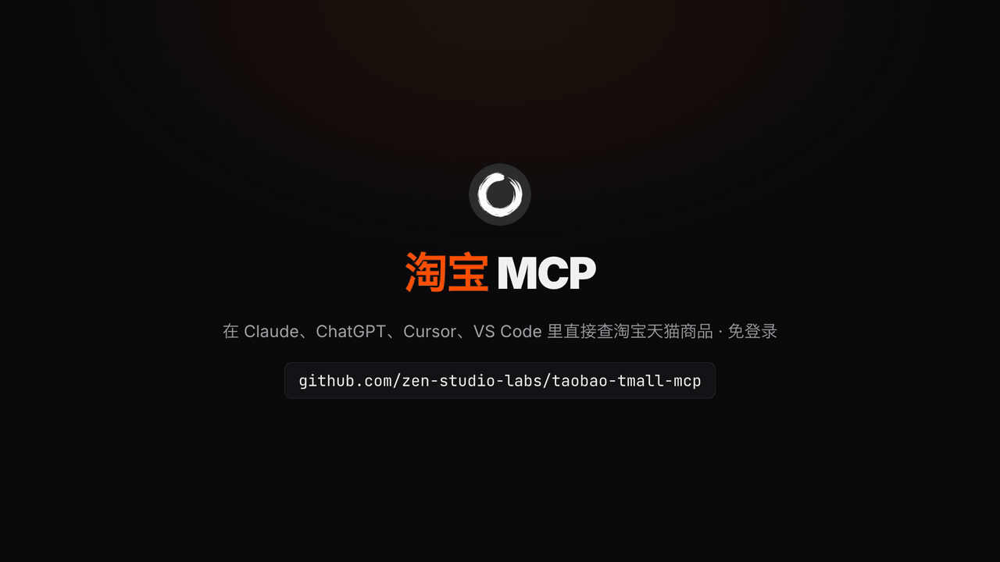
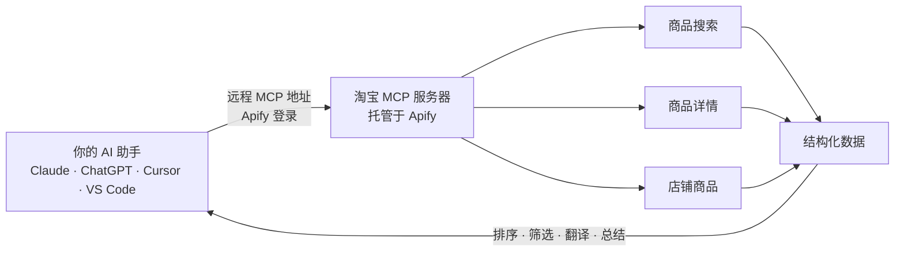

<div align="center">


# 淘宝 & 天猫 MCP（Taobao / Tmall MCP Server）

**让 Claude、ChatGPT、Cursor 等 AI 助手直接搜索淘宝和天猫商品、比价看销量、读取 SKU 规格和买家评价、查看店铺在售商品。云端托管，免登录，不用 Cookie，不用部署，也可通过 API 调用。**

[English](README.md) · **简体中文**

[](https://apify.com/zen-studio/taobao-detail-scraper)
[](https://github.com/zen-studio-labs/taobao-tmall-mcp/actions/workflows/validate.yml)
[](LICENSE)



<sub>画面数据来自 2026 年 11 月 2 日的一次真实搜索。</sub>

[](https://cursor.com/en/install-mcp?name=taobao&config=eyJ1cmwiOiJodHRwczovL21jcC5hcGlmeS5jb20vP3Rvb2xzPWZldGNoLWFjdG9yLWRldGFpbHMsZ2V0LWFjdG9yLXJ1bixnZXQtZGF0YXNldC1pdGVtcyx6ZW4tc3R1ZGlvL3Rhb2Jhby1zZWFyY2gtc2NyYXBlcix6ZW4tc3R1ZGlvL3Rhb2Jhby1kZXRhaWwtc2NyYXBlcix6ZW4tc3R1ZGlvL3Rhb2Jhby1zZWxsZXItcHJvZHVjdHMtc2NyYXBlciJ9)
[](https://vscode.dev/redirect/mcp/install?name=taobao&config=%7B%22type%22%3A%22http%22%2C%22url%22%3A%22https%3A%2F%2Fmcp.apify.com%2F%3Ftools%3Dfetch-actor-details%2Cget-actor-run%2Cget-dataset-items%2Czen-studio%2Ftaobao-search-scraper%2Czen-studio%2Ftaobao-detail-scraper%2Czen-studio%2Ftaobao-seller-products-scraper%22%7D)
[](#客户端配置)

[快速开始](#快速开始) · [让 AI 帮你安装](#让-ai-助手帮你安装) · [工具](#工具) · [提问示例](#提问示例) · [客户端配置](#客户端配置) · [API](#淘宝-api代码调用) · [价格](#价格) · [常见问题](#常见问题)

</div>

淘宝 MCP 让你的 AI 助手直接读取淘宝（Taobao）和天猫（Tmall）的商品数据。用中文或英文提问都行：按关键词搜索商品，可按销量排序、限定价格区间、只看天猫；查看单个商品的完整详情，包括各个 SKU 的价格和库存、规格参数、主图和详情图；需要时附带买家评价；还能列出一家店铺的全部在售商品。结果是结构化数据，AI 助手可以直接排序、筛选、翻译和总结，适合比价、选品找货源、代购和品牌监控。开发者也可以把它当作淘宝 API 在代码里调用。

## 为什么选择淘宝 MCP

- **免登录，不用密钥。** 不用扫码，不用导出 Cookie，也不用申请淘宝联盟 PID 或开放平台 AppKey。全程不使用你的淘宝账号，不怕封号。
- **无需部署。** 云端托管的远程 MCP 服务：填入一个地址，登录 Apify 即可使用。不用 Docker，不用本地浏览器，也不用装 Python 或 Node 环境；网页版 claude.ai 和 ChatGPT 也能用。
- **淘宝、天猫一起查。** 商品搜索、商品详情（可选买家评价）、店铺商品列表三个工具，淘宝 C 店和天猫旗舰店都支持。
- **数据丰富且结构化。** 价格和优惠价（人民币）、销量、各个 SKU 的价格和库存、规格参数、品牌、类目、主图、视频、店铺名称、好评率和店铺评分（描述、服务、物流）、发货地，以及带图片和商家回复的买家评价。
- **持续维护。** Apify Store 上已有超过 10,000 名用户。淘宝改版时我们负责适配，你的配置不用改。
- **为 AI 助手优化。** 自带 Skill，告诉 AI 助手怎么传参、怎么组合调用各个工具；耗时较长的任务在后台继续跑，AI 助手会自动轮询进度。
- **按量付费。** 按返回结果计费（另有少量单次启动费），从你自己的 Apify 账号扣费，无需订阅，可用 Apify 免费套餐试用。

| | 淘宝 MCP | 开源自部署方案 |
|---|---|---|
| 淘宝账号、扫码登录或 Cookie | 不需要 | 通常需要，登录态过期还得重新扫码 |
| 淘宝联盟 PID 或开放平台密钥 | 不需要 | 淘宝客转链和商家后台类工具必须申请 |
| 你自己的淘宝账号 | 从不使用 | 每个请求都用你的账号发出，封号风险自己扛 |
| 安装配置 | 一个地址加一次 Apify 登录 | Python 或 Node，本地 Chrome 保持登录，或者 Docker |
| 网页版 AI 助手（claude.ai、ChatGPT） | 支持 | 通常只支持桌面客户端 |
| 淘宝改版后 | 我们负责适配 | 等作者修复，或自己修 |
| SKU、买家评价、店铺商品列表 | 全部包含 | 不一定，淘宝客工具主要返回推广链接和佣金 |
| 成本 | 按结果计费 | 软件免费，但要自己维护环境、花时间折腾 |

## 工作原理



每次调用工具，都会在你的 Apify 账号下创建一个运行任务（Run）。AI 助手等任务完成后读取数据，再用自然语言回答你。多个工具可以组合使用：先按关键词搜索，再打开销量靠前的商品看 SKU 规格和买家评价，最后看看这些店铺还卖什么。

## 快速开始

1. 注册免费的 [Apify 账号](https://console.apify.com/sign-up)。
2. **把服务器添加到 AI 助手。** 点击上方按钮，或按下方对应客户端的步骤操作。
3. **AI 助手提示时登录 Apify**，然后直接提问，例如：“搜索淘宝上销量最高的机械键盘，对比店铺、价格、销量和店铺评分。”

**关于 Apify 授权页面。** 页面会提示该应用为“动态注册、未经 Apify 验证”，并请求完整的 API 访问权限。所有以这种方式登录的 AI 助手都会看到这一提示，它允许 AI 助手在你的账号上启动运行。授权可随时在 [Apify 控制台集成页面](https://console.apify.com/settings/integrations) 撤销。

服务器地址，适用于所有支持远程 MCP 服务器的客户端：

```text
https://mcp.apify.com/?tools=fetch-actor-details,get-actor-run,get-dataset-items,zen-studio/taobao-search-scraper,zen-studio/taobao-detail-scraper,zen-studio/taobao-seller-products-scraper
```

## 让 AI 助手帮你安装

把本仓库的地址粘贴给 Claude Code、Codex、Cursor 或其他 AI 助手，让它帮你安装淘宝 MCP。下面的步骤专门写给 AI 助手执行。

**以下内容供 AI 助手执行：**

1. 这是一个托管的远程 MCP 服务器（streamable HTTP），无需下载或构建。需要一个免费的 Apify 账号，并在用户浏览器中完成 Apify 登录（OAuth）；除非登录失败，否则不要向用户索要 API Token。
2. 服务器名称 `taobao`，服务器地址：
   ```text
   https://mcp.apify.com/?tools=fetch-actor-details,get-actor-run,get-dataset-items,zen-studio/taobao-search-scraper,zen-studio/taobao-detail-scraper,zen-studio/taobao-seller-products-scraper
   ```
3. 使用客户端自带的命令添加：
   - Claude Code：`claude plugin marketplace add zen-studio-labs/taobao-tmall-mcp`，然后 `claude plugin install taobao@taobao-tmall-mcp`（同时安装服务器和淘宝技能）。
   - Codex：`codex mcp add taobao --url "<服务器地址>"`，然后 `codex mcp login taobao`。
   - VS Code：`code --add-mcp '{"name":"taobao","type":"http","url":"<服务器地址>"}'`。
   - Cursor 及其他客户端：在客户端的 MCP 配置文件中加入 `{"mcpServers": {"taobao": {"url": "<服务器地址>"}}}`（Cursor：`~/.cursor/mcp.json`）。
4. 请用户完成登录。在 Claude Code 中运行 `/mcp`，选择 taobao 并点击 **Authenticate**；其他客户端会自动打开 Apify 登录页面。工具出现前可能需要重启客户端。
5. 不启动付费运行即可验证：对 `zen-studio/taobao-detail-scraper` 调用 `fetch-actor-details`，能返回输入说明即说明连接正常。不要做测试运行：Apify 免费套餐下每次运行都计入很少的额度（商品搜索共 5 次，商品详情共 10 次），留给用户的真实需求。
6. 正式使用前，请阅读[淘宝技能](skills/taobao/SKILL.md)：其中说明了长时间运行的处理方式、工具串联方法以及效果最好的参数。

## 工具

| 工具 | 返回内容 | Apify 页面 |
|---|---|---|
| 商品搜索 | 按关键词搜索淘宝和天猫商品：标题、价格和优惠价、销量区间（如 `1万+`）、店铺名称、好评率、三项店铺评分和发货地。可按综合、销量或价格从高到低排序，可限定价格区间或只看天猫。可选为每个商品附带完整详情和买家评价。每个关键词最多 1,000 个商品。 | [taobao-search-scraper](https://apify.com/zen-studio/taobao-search-scraper) |
| 商品详情 | 通过商品链接、分享短链（`e.tb.cn`）、淘宝客推广链接或商品 ID 获取完整详情：各个 SKU 的价格和库存、规格参数、品牌、类目、主图、详情图、视频、店铺、发货地和销量。可选买家评价，含晒图、商家回复和追评。每次最多 1,000 个商品。 | [taobao-detail-scraper](https://apify.com/zen-studio/taobao-detail-scraper) |
| 店铺商品 | 一家店铺的全部在售商品，可传该店任意商品链接（推荐）、淘宝店铺链接、店铺域名前缀（如 `inman`，即 inman.taobao.com），或卖家 ID 加店铺 ID：标题、价格和优惠价、近 30 天销量和订单数（淘宝显示时）、评价数、是否包邮、类目和店铺评分。可按综合、销量、新品、价格从低到高或从高到低排序。每家店铺最多 5,000 个商品。 | [taobao-seller-products-scraper](https://apify.com/zen-studio/taobao-seller-products-scraper) |

所有工具均为只读，不会登录、加购、下单、联系卖家或发表评价。

<details>
<summary><b>各工具主要字段</b></summary>

| 工具 | 主要字段 |
|---|---|
| 商品搜索 | `itemId`、`url`、`title`、`price`、`discountedPriceFromSearch`（优惠价）、`salesSignal`（销量区间）、`shop.shopNameFromSearch`、`shop.shopIdFromSearch`、`sellerGoodrat`（好评率，%）、`miaoshuDsr`、`fuwuDsr`、`fahuoDsr`（描述、服务、物流评分，满分 5）、`sellerLoc`、`searchRank`；开启 `enrichWithDetails` 后另含商品详情字段，如 `isTmall`、`sales`、`skus`、`attributes`；开启 `fetchReviews` 后另含 `reviews[]` |
| 商品详情 | `itemId`、`url`、`isTmall`、`title`、`price`、`originalPrice`、`sales`、`totalSold`、`stock`、`skuCount`、`skus[]`（每个规格的价格和库存）、`attributes`、`brandName`、`categoryCrumbs`、`mainPictureUrl`、`pictures`、`descriptionImages`、`video`、`shop.shopName`、`shop.shopUrl`、`shop.sellerId`、`location`、`detailLevel`；开启 `fetchReviews` 后另含 `reviews[]`：`content`、`date`、`photos`、`reply`、`appendList`（追评）、`useful` |
| 店铺商品 | `shopName`、`shopUrl`、`sellerId`、`shopId`、`itemId`、`url`、`title`、`price`、`discountPrice`、`soldCount30Day`、`orderCount30Day`、`commentCount`、`freeShipping`、`shop.descriptionMatchScore`、`shop.serviceScore`、`shop.deliveryScore`、`catalog.rank`、`catalog.totalCount` |

完整字段见各工具的 Apify 页面。

</details>

## 提问示例

**比价与价格调研**
- *淘宝上 200 到 600 元的机械键盘，销量前 20 的是哪些？列出店铺、优惠价、销量和店铺评分。*
- *这款键盘别的店卖多少？搜索型号，列出价格最低的五家店：https://item.taobao.com/item.htm?id=844075013790*

**选品与找货源**
- *把这个商品所有颜色和尺码的价格、库存都列出来：https://item.taobao.com/item.htm?id=844075013790*
- *只看天猫，300 元以内的筋膜枪按销量排个序。*

**品牌与店铺监控**
- *这家店卖得最好的商品有哪些？列出价格、优惠价和近 30 天销量：https://item.taobao.com/item.htm?id=844075013790*
- *淘宝上有哪些店在卖乐高？哪些是天猫旗舰店？*

**买家评价分析**
- *读取这个商品的 50 条买家评价，按问题类型归纳差评：https://item.taobao.com/item.htm?id=844075013790*
- *销量前三的空气炸锅，评价里有没有人提到噪音或异味？把相关评价摘出来。*

**用英文提问也可以**
- *Find the best-selling mechanical keyboards (机械键盘) on Taobao and compare shop, price, sales and shop rating.*
- *Translate every option of this product into English with its price and stock: https://item.taobao.com/item.htm?id=844075013790*

提示：中文商品请用中文关键词搜索（如 `机械键盘`、`连衣裙`、`空气炸锅`），这与卖家起商品标题的方式一致。品牌名和型号（如 `Lego`、`G87`）可直接使用。

## 客户端配置

<details open>
<summary><b>Claude（claude.ai 和 Claude Desktop）</b></summary>

1. 打开 **Settings** > **Connectors**，选择 **Add custom connector**。
2. 名称填写 `Taobao`，粘贴上方的服务器地址。
3. 点击 **Connect** 并登录 Apify。
4. 在对话中，从工具菜单启用 Taobao 连接器。

连接器会在 claude.ai 和 Claude Desktop 之间同步。自定义连接器是否可用取决于你的 Claude 套餐。建议同时添加[淘宝技能](skills/taobao/SKILL.md)：下载 [taobao-skill.zip](https://github.com/zen-studio-labs/taobao-tmall-mcp/releases/latest/download/taobao-skill.zip)，在 Claude 设置的 **Skills** 中上传。

</details>

<details>
<summary><b>Claude Code</b></summary>

插件（服务器加淘宝技能，推荐）：

```text
/plugin marketplace add zen-studio-labs/taobao-tmall-mcp
/plugin install taobao@taobao-tmall-mcp
```

仅添加服务器：

```bash
claude mcp add --transport http taobao "https://mcp.apify.com/?tools=fetch-actor-details,get-actor-run,get-dataset-items,zen-studio/taobao-search-scraper,zen-studio/taobao-detail-scraper,zen-studio/taobao-seller-products-scraper"
```

然后登录：运行 `/mcp`，选择 taobao 服务器并点击 **Authenticate**。登录前，`/mcp` 会显示服务器未认证，并可能提示无法获取工具；登录后即恢复正常。

</details>

<details>
<summary><b>Cursor</b></summary>

点击上方的 **Install in Cursor**，或把 [`examples/cursor-mcp.json`](examples/cursor-mcp.json) 加入 `~/.cursor/mcp.json`（所有项目）或 `.cursor/mcp.json`（单个项目）。首次使用时 Cursor 会提示登录 Apify。

</details>

<details>
<summary><b>VS Code 和 GitHub Copilot</b></summary>

点击上方的 **Install in VS Code**（[VS Code Insiders](https://insiders.vscode.dev/redirect/mcp/install?name=taobao&config=%7B%22type%22%3A%22http%22%2C%22url%22%3A%22https%3A%2F%2Fmcp.apify.com%2F%3Ftools%3Dfetch-actor-details%2Cget-actor-run%2Cget-dataset-items%2Czen-studio%2Ftaobao-search-scraper%2Czen-studio%2Ftaobao-detail-scraper%2Czen-studio%2Ftaobao-seller-products-scraper%22%7D&quality=insiders)），或把 [`examples/vscode-mcp.json`](examples/vscode-mcp.json) 加入 `.vscode/mcp.json`。在 MCP 视图中启动服务器，并按提示登录 Apify。在 Copilot Chat 的 Agent 模式中使用这些工具。

</details>

<details>
<summary><b>ChatGPT</b></summary>

1. 打开 [ChatGPT Plugins](https://chatgpt.com/plugins)，点击 **+**，选择 **Add custom MCP server**。
2. 名称填写 `Taobao`，粘贴上方的服务器地址，认证方式选择 **OAuth**。
3. 确认并创建插件，然后登录 Apify。
4. 在新对话中输入 `@` 并选择 **Taobao**。

Business、Enterprise 和 Edu 工作区可能需要管理员开启自定义服务器。详见 OpenAI 的[自定义 MCP 服务器指南](https://help.openai.com/en/articles/12584461-connecting-custom-mcp-servers-in-chatgpt)。

</details>

<details>
<summary><b>Codex</b></summary>

```bash
codex mcp add taobao --url "https://mcp.apify.com/?tools=fetch-actor-details,get-actor-run,get-dataset-items,zen-studio/taobao-search-scraper,zen-studio/taobao-detail-scraper,zen-studio/taobao-seller-products-scraper"
codex mcp login taobao
```

或把 [`examples/codex-config.toml`](examples/codex-config.toml) 复制到 `~/.codex/config.toml`。

</details>

<details>
<summary><b>其他客户端，或用 Token 代替登录</b></summary>

大多数支持远程 MCP 服务器的客户端接受以下配置：

```json
{
  "mcpServers": {
    "taobao": {
      "url": "https://mcp.apify.com/?tools=fetch-actor-details,get-actor-run,get-dataset-items,zen-studio/taobao-search-scraper,zen-studio/taobao-detail-scraper,zen-studio/taobao-seller-products-scraper"
    }
  }
}
```

如果客户端无法完成 Apify 登录，可以改用请求头传递 Apify Token，见 [`examples/bearer-token-mcp.json`](examples/bearer-token-mcp.json)。Token 可在 [Apify 控制台集成页面](https://console.apify.com/settings/integrations) 复制，请勿放入共享文件。只支持本地服务器的客户端可以通过 `mcp-remote` 桥接，见 [`examples/claude-desktop-config.json`](examples/claude-desktop-config.json)。

</details>

## 淘宝 API：代码调用

每个工具同时也是一个带 REST API 的 [Apify Actor](https://apify.com/zen-studio)，可以在你自己的代码、数据管道或自动化流程中直接调用，无需 AI 助手，也不用申请淘宝开放平台或淘宝联盟账号。API Token 可在 [Apify 控制台集成页面](https://console.apify.com/settings/integrations) 复制。输入参数与 AI 助手使用的完全相同；每个 Store 页面的 **API** 标签页都有现成的代码和完整参数说明。

<details open>
<summary><b>Python</b></summary>

```bash
pip install apify-client
```

```python
import os
from apify_client import ApifyClient

client = ApifyClient(os.environ["APIFY_TOKEN"])
run = client.actor("zen-studio/taobao-search-scraper").call(
    run_input={"keyword": "机械键盘", "maxItems": 20, "sort": "sales", "enrichWithDetails": False}
)
for item in client.dataset(run["defaultDatasetId"]).iterate_items():
    if item.get("error") or "price" not in item:
        print("notice:", item.get("message") or item.get("error"))  # 提示行，不是商品
        continue
    print(item["price"], item.get("salesSignal"), item["title"], item["url"])
```

</details>

<details>
<summary><b>JavaScript 和 TypeScript</b></summary>

```bash
npm install apify-client
```

```js
import { ApifyClient } from 'apify-client';

const client = new ApifyClient({ token: process.env.APIFY_TOKEN });
const run = await client.actor('zen-studio/taobao-detail-scraper').call({
    items: ['https://item.taobao.com/item.htm?id=844075013790'],
    fetchReviews: true,
    maxReviewsPerItem: 20,
});
const { items } = await client.dataset(run.defaultDatasetId).listItems();
console.log(items);
```

</details>

<details>
<summary><b>HTTP</b></summary>

一个请求启动运行并返回结果：

```bash
curl -X POST "https://api.apify.com/v2/acts/zen-studio~taobao-search-scraper/run-sync-get-dataset-items" \
  -H "Authorization: Bearer $APIFY_TOKEN" \
  -H "Content-Type: application/json" \
  -d '{"keyword": "机械键盘", "maxItems": 20, "sort": "sales"}'
```

该请求最多等待 300 秒。数据量更大时，请异步启动运行，完成后再读取数据集，见 [Apify API 文档](https://docs.apify.com/api/v2/act-run-sync-get-dataset-items-post)。

</details>

<details>
<summary><b>n8n、Make 和 Zapier</b></summary>

使用 Apify 官方的 [n8n](https://docs.apify.com/platform/integrations/n8n)、[Make](https://docs.apify.com/platform/integrations/make) 或 [Zapier](https://docs.apify.com/platform/integrations/zapier) 集成，选择对应的 Actor（例如 `zen-studio/taobao-search-scraper`）并传入相同的 JSON 参数。

</details>

其他工具：把 Actor ID 换成 `zen-studio/taobao-detail-scraper` 或 `zen-studio/taobao-seller-products-scraper`。

## 使用场景

- **比价与价格监控。** 同一品类、品牌或型号在不同店铺的价格、优惠价和销量，一次看清。
- **选品与找货源。** 先看什么卖得好，再把 SKU 规格、选项和库存查清楚，然后再下单或上架。
- **代购与跨境购物。** 把客户发来的淘宝或天猫链接，变成带规格和价格的翻译版商品信息。
- **品牌监控。** 哪些店在卖你的品牌、卖什么价，哪些是天猫旗舰店或授权专卖店。
- **竞品店铺跟踪。** 一家店的全部在售商品，带价格和近 30 天销量，按你需要的方式排序。
- **买家评价分析。** 带晒图和商家回复的评价数据，可直接用于情绪分析和差评归类。

## 输出示例

2026 年 11 月 2 日那次搜索中的一条结果（节选）。AI 助手读取这样的数据后，会用自然语言回答你。

```json
{
  "itemId": "844075013790",
  "url": "https://item.taobao.com/item.htm?id=844075013790",
  "title": "迈从Ace 68V2 磁轴机械键盘60Pro游戏电竞台式电脑客制化打瓦桌搭",
  "priceCurrency": "CNY",
  "price": "499.00",
  "discountedPriceFromSearch": "279.35",
  "salesSignal": "1万+",
  "shop": {
    "shopIdFromSearch": "521309573",
    "shopNameFromSearch": "迈从官方旗舰店"
  },
  "sellerGoodrat": 100,
  "miaoshuDsr": 4.87,
  "fuwuDsr": 4.88,
  "fahuoDsr": 4.88,
  "searchKeyword": "机械键盘",
  "searchSort": "sales",
  "searchRank": 1
}
```

## 长时间请求如何处理

每次工具调用最多约 45 秒返回。数据量较大的请求会在 Apify 上继续运行，AI 助手会持续查询，直到结果就绪，再分页读取。期间你可能会看到几次“仍在运行”的提示，这是正常的。[淘宝技能](skills/taobao/SKILL.md)会教 AI 助手这套流程以及每个工具的参数用法；Claude Code 通过插件自动获得该技能。

## 价格

按结果计费（另有少量单次启动费），从你的 Apify 账号扣费，本仓库不收取任何订阅费。最新价格（含批量折扣）见各工具的定价页面：

- [商品搜索](https://apify.com/zen-studio/taobao-search-scraper/pricing)
- [商品详情](https://apify.com/zen-studio/taobao-detail-scraper/pricing)
- [店铺商品](https://apify.com/zen-studio/taobao-seller-products-scraper/pricing)

AI 助手通过 `maxItems`、`maxItemsPerSeller`、`maxReviewsPerItem` 等上限控制成本。建议先小批量试跑，确认结果后再加量。商品搜索默认为每个商品附带完整详情，按商品单独计费；买家评价在搜索和详情中都按条计费。只需要价格和销量时，把这两项关掉即可。

**Apify 免费套餐：** 每个工具可少量试用，结果数有上限。商品搜索：总共 5 次，每次一页 10 个商品，仅第一个商品附带完整详情。商品详情：10 次，每次 1 个商品。店铺商品：10 次，每次最多 20 个商品。买家评价需付费套餐。免费试用可能暂时不可用，可稍后再试，或使用任意付费套餐。任何付费套餐均可解除限制。

## 限制说明

- **价格仅供参考，单位人民币。** 商品详情中的 `price` 是含当前促销的售价，`originalPrice` 是有折扣时的原价。商品搜索中，关闭详情时 `price` 是搜索结果里的价格；开启详情（默认）时 `price` 会替换为商品详情的价格，搜索结果里的价格保留在 `priceFromSearch` 中。`discountedPriceFromSearch` 是搜索结果显示的优惠价。同一商品的这几个价格可能不同，引用时请注明是哪一个。券后价 `couponPrice` 经常为空，实际下单价可能更低；`priceVerified` 为 `true` 表示该 `price` 已核实。按价格做决定前请再核对一次。
- **SKU 列表可能不完整。** 少数商品返回的规格数量少于商品页面上显示的数量。需要完整规格时，请对照商品页面核对。
- **搜索结果里的销量是区间。** `salesSignal` 显示为 `1000+` 或 `1万+`；商品详情在淘宝显示具体数字时会返回数字。店铺商品中，淘宝显示为区间的数量按下限返回（`100+` 返回 `100`，`1万+` 返回 `10000`），因此 `soldCount30Day`、`orderCount30Day` 和 `commentCount` 应理解为“至少”。
- **部分商品字段较少。** 详情行的 `detailLevel` 为 `partial` 时，库存、销量、运费和视频为空；标题、价格、SKU、图片和规格参数仍然完整。
- **每次搜索一个关键词。** 多个关键词由 AI 助手分别搜索。
- **店铺商品不支持天猫店铺链接**（如 `brand.tmall.com`）。请改用该店任意商品链接；淘宝店铺链接可以直接用。
- **不支持拍照搜同款，也没有首页推荐和排行榜。** 可用按销量排序的关键词搜索代替。
- **只读。** 不能登录、加购、下单、联系卖家，也不提供商家后台数据。

评价中的买家昵称已由淘宝脱敏。请合理使用数据，遵守淘宝的用户协议以及适用的数据保护法规（如《个人信息保护法》、GDPR）。

## 故障排查

- **`/mcp` 显示服务器未认证，或无法获取工具。** 选择该服务器并点击 **Authenticate**。其他客户端会显示 **Connect** 或 **Sign in** 按钮。
- **搜索结果很少。** 关键词越窄，结果越少。试试中文词、更短的关键词，或去掉价格区间和“只看天猫”。
- **搜索停在 10 个商品、商品详情只返回 1 个商品，或免费次数已用完。** 这是 Apify 免费套餐的限制，任何付费套餐均可解除。
- **没有返回评价，运行提示评价仅限付费方案。** 这是 Apify 免费套餐的限制，任何付费套餐均可获取评价。
- **运行提示免费试用暂时不可用。** 稍后再试，或升级到付费套餐。
- **商品详情对某个链接没有返回结果。** 按运行状态信息操作：提示立即重试不太可能有效时，不要马上重跑同样的商品；提示几分钟后再试时，按提示稍后再试。没有返回结果的商品不计费。
- **店铺商品找不到店铺。** 纯数字会被当作卖家 ID，单独使用无法定位店铺。请传该店任意商品链接，或 `itemId:<商品ID>`。
- **AI 助手提示运行仍在进行。** 数据量较大时属于正常现象。让它继续查询同一次运行即可；为同一问题重新发起请求会再次计费。
- **客户端无法完成登录。** 改用 Apify Token 请求头，见[其他客户端](#客户端配置)。

## 常见问题

**和开源的淘宝 MCP、淘宝客 MCP 有什么区别？**
开源项目大多有两类：一类在本地用浏览器登录你自己的淘宝账号操作，要扫码、存 Cookie，登录态过期还得重新折腾；另一类封装淘宝联盟接口，需要申请 PID 和密钥，主要用来生成推广链接和查佣金。本项目是云端托管的只读服务：免登录，不用密钥，不用部署，网页版 claude.ai 和 ChatGPT 也能用；专注商品调研：价格、销量、SKU、买家评价和店铺商品。

**支持天猫吗？**
支持。商品搜索可以只看天猫，商品详情接受 `detail.tmall.com` 链接并用 `isTmall` 标出天猫商品，店铺商品接受天猫商品链接。

**会影响我的淘宝账号吗？**
不会。全程不需要也不使用你的淘宝账号，只需一个 Apify 账号，一分钟即可注册。

**有淘宝 API 吗？**
有。每个工具都可以通过 REST API 或 Apify 的 Python、JavaScript 客户端调用，见[淘宝 API：代码调用](#淘宝-api代码调用)。不需要淘宝开放平台或淘宝联盟账号。

**能看买家评价吗？**
能。在商品详情或商品搜索中开启 `fetchReviews` 并设置 `maxReviewsPerItem`。评价包含文字、时间、晒图、商家回复和追评，按条计费，需付费套餐。

**价格是人民币吗？**
是的，单位为人民币（CNY）。可以让 AI 助手换算成你需要的币种。

**可以下单、加购或联系卖家吗？**
不可以。所有工具在设计上都是只读的。

**数据是实时的吗？**
是的。结果反映你提问时淘宝上的最新信息。

**支持哪些 AI 助手？**
所有支持远程 MCP 服务器的客户端，包括 Claude（claude.ai、Claude Desktop、Claude Code）、ChatGPT、Codex、Cursor、VS Code（GitHub Copilot）等。

**免费吗？**
可以在 Apify 免费套餐上试用，每个工具有少量试用次数。之后按结果计费，见[价格](#价格)。

**这是淘宝官方产品吗？**
不是。本项目由 Zen Studio 独立开发，非淘宝官方产品，与淘宝、天猫和阿里巴巴无任何隶属或合作关系。

## 隐私

请求发送至 Apify 托管的 MCP 服务器，并在你的 Apify 账号上运行，适用 Apify 的[隐私政策](https://docs.apify.com/legal/privacy-policy)。本仓库只包含配置和说明，不收集任何数据。

## Zen Studio 的更多工具

淘宝 MCP 基于 [Zen Studio 的 Apify Actors](https://apify.com/zen-studio) 构建。你也可以直接在 Apify 上运行每个工具，通过 API 调用或设置定时任务。需要闲鱼二手商品数据？试试 [闲鱼 MCP（Goofish MCP）](https://github.com/zen-studio-labs/goofish-mcp)。需要小红书笔记、评论和博主数据？试试 [小红书 MCP（RedNote MCP）](https://github.com/zen-studio-labs/rednote-xiaohongshu-mcp)。

## 许可证

[MIT](LICENSE)。淘宝、Taobao、天猫、Tmall 和阿里巴巴为其各自权利人的商标。
